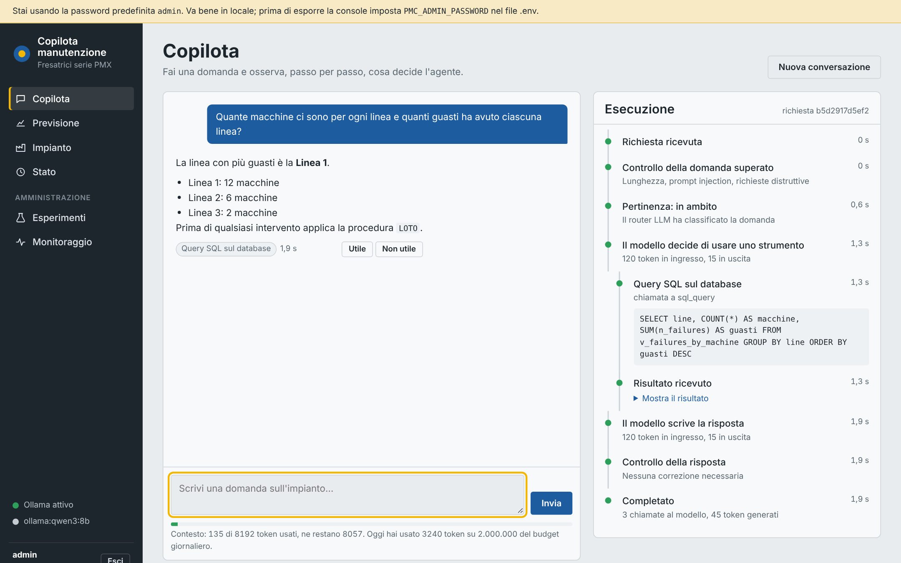
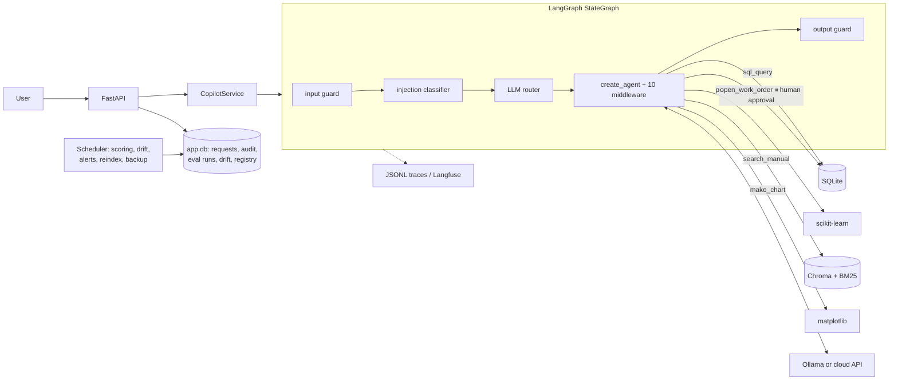

# Predictive Maintenance Copilot

[](https://github.com/AndreaVGN/predictive-maintenance-copilot/actions/workflows/ci.yml)


An agentic RAG assistant for predictive maintenance on a CNC milling plant. It combines a **scikit-learn failure model**, a **SQL plant database**, **hybrid retrieval over maintenance manuals**, and a **LangGraph agent** running on a **local LLM via Ollama** (or a cloud API). It is built like a production service: authentication and roles, usage limits, guardrails, human-in-the-loop approval, tracing, drift monitoring, a model registry, and an evaluation history with run-vs-run comparison and quality gates.

> 🇮🇹 Code comments and the module-by-module documentation ([`docs/`](docs/index.md), an MkDocs site) are in Italian.

Example interaction (illustrative; the real assistant answers in Italian):

```text
you > Which machines are at high risk right now, and what does the manual say about the main cause?
copilot > M07 and M13 are at high risk (82% and 64%). For M07 the dominant factor is overstrain:
          tool wear × torque = 12,400, above the 11,000 limit for type L machines. The manual
          recommends reducing cutting load and bringing tool replacement forward [1], always
          after LOTO lockout [2].
          [1] 04_osf_sovraccarico.md › Interventi correttivi  [2] 06_sicurezza_loto.md › Procedura LOTO
  [tools: sql_query, predict_failure, search_manual · 6840 ms · 4 LLM calls]
```



*The web console (Italian UI): on the right, every step of the agent streamed live, including the SQL query the LLM wrote.*

## What it does

| Capability | How |
|---|---|
| Failure prediction | scikit-learn pipeline (4 models × 2 feature sets compared with stratified CV, F1-tuned threshold, model card) |
| Physics-informed features | numpy: mechanical power, thermal delta, wear × torque. An ablation study measures their contribution |
| Natural-language analytics | text-to-SQL on SQLite: parser-validated, read-only connection, timeout |
| Grounded answers | hybrid RAG over maintenance manuals: dense (Chroma, `nomic-embed-text`) + BM25 written from scratch, fused with Reciprocal Rank Fusion; metadata filtering by failure mode; incremental re-indexing; citations |
| What-if scenarios | "what happens to M03 if torque rises to 65 Nm?" → the ML model on modified readings |
| Actions with approval | opening a work order pauses the graph (`interrupt`) until a human approves |
| Charts on demand | matplotlib PNGs served by the API |
| Model lifecycle | model registry with champion/challenger on the same test set, promotion and rollback from the console |
| Drift monitoring | PSI and KS on inputs, PSI on predictions, performance drop for concept drift; five simulated drift scenarios |
| Local or cloud LLM | Ollama by default; OpenAI or Anthropic by changing two env vars, with cost tracking |

## Architecture



**Why a graph around an agent?** Safety checks must run on every request, not only when the model remembers them. Deterministic nodes run before and after the agent. Inside, the ReAct loop chooses tools freely and self-corrects on tool errors.

## Web console

`make api` serves the console at http://localhost:8000 (default login `admin` / `admin`, change it in `.env`). Views:

- **Copilot**: chat with the agent. An execution panel streams every step live over Server-Sent Events: graph nodes, model decisions, the SQL the LLM wrote, tool arguments and results, guardrail flags, and approval pauses. Context-window meter, cost, feedback buttons, Langfuse trace links.
- **Prediction**: the ML model alone, with sliders and what-if scenarios.
- **Plant**: all machines with their estimated risk, recent sensor trends, maintenance history, and work orders with who approved them.
- **Status**: component health, configuration, and usage metrics.
- **Experiments** (admin): launch evaluations (agent, retrieval, guardrails, ML model), see metric trends, pick two runs and compare them case by case (regressions first, side-by-side answers, config changes, prompt diff), and apply the quality gate.
- **Monitoring** (admin): alerts, drift reports with diagnosis, drift simulation, periodic jobs, model registry with promote/rollback, daily usage, audit log.

The console is plain HTML, CSS and JavaScript modules served by FastAPI, with no build step.

## Production concerns

- **Auth and limits:** admin/operator roles enforced server-side, HMAC-signed HttpOnly session cookies, HTTP Basic for scripts, constant-time password checks, login lockout, sliding-window rate limit, per-user daily token budget. With `PMC_ENV=prod` the API refuses to start with the default password.
- **Guardrails (defense in depth):** prompt-injection rules plus an optional LLM classifier, LLM scope router, AST-based SQL validation with a table whitelist, read-only DB connection and query timeout, model-call / tool-call / token limits per request, human-in-the-loop for writes, indirect prompt injection scrubbing on tool outputs, sanitized notes, output check (canary token, hallucinated machine IDs, enforced citations), PII redaction in logs and traces.
- **Agent resilience:** LangChain 1.x middleware for retries with exponential backoff, model fallback, tool retries, history summarization before the context window fills, and a SQLite checkpointer so conversations and pending approvals survive restarts.
- **Observability:** rotated JSON logs with request IDs, a callback tracer (per-node latency, tokens, context peak, tool errors), self-hosted Langfuse (users, sessions, prompt-version releases, user-feedback and judge scores), Prometheus metrics, six alert rules with webhook, an in-process scheduler (scoring, drift, alerts, re-indexing, consistent SQLite backups with retention), and an audit log.
- **Evaluation history:** every run (agent, retrieval, guardrails, ML model) is stored with its full config, prompt text, and per-case results. Runs can be compared A→B and checked against quality gates (absolute thresholds and max drop vs a baseline) that fail CI.
- **Testing:** 105 pytest tests with a scripted fake chat model (no LLM needed), smoke tests against a running instance, and a CI pipeline with lint, tests, quality gates, smoke tests, and a Docker build.

## Results

Measured on the real [AI4I 2020](https://archive.ics.uci.edu/dataset/601/ai4i+2020+predictive+maintenance+dataset) dataset with `qwen3:8b` running locally on Ollama. Full reports: [`reports/model_report.md`](reports/model_report.md) and [`reports/eval_report.md`](reports/eval_report.md).

**Failure model**: temporal split (8,000 train / 2,000 test rows, 1.95% failures in the test set), threshold tuned on out-of-fold predictions of the train set, test set used once.

| Model | PR-AUC | ROC-AUC | Precision | Recall | F1 |
|---|---|---|---|---|---|
| HistGradientBoosting + physics features | 0.768 | 0.939 | 1.00 | 0.72 | 0.84 |

Physics-informed features help every model in cross-validation: PR-AUC goes from 0.833 to 0.910 for gradient boosting and from 0.777 to 0.902 for random forest (dummy baseline: 0.037).

**RAG, guardrails and agent**

| Area | Metric | Value |
|---|---|---|
| Retrieval (25 golden questions) | hit@1 / hit@4 / MRR | 0.84 / 0.96 / 0.89 |
| Input guardrail (30 cases) | detection / false positives | 0.88 / 0.00 |
| SQL guardrail (20 cases) | detection / false positives | 1.00 / 0.00 |
| Agent end-to-end (16 cases) | routing / tool selection / keyword hit | 1.00 / 0.69 / 0.81 |
| Agent end-to-end | faithfulness (LLM-as-a-judge, 1-5) | 4.67 |
| Agent end-to-end | human-approval gate respected | 100% |
| Agent end-to-end | latency p50 / p95 | 8.9 s / 22.6 s |

The judge was the same 8B model as the agent, so faithfulness is indicative; a stronger judge can be set with `PMC_JUDGE_MODEL`. Tool selection (0.69) is the main weakness of a small local model and the first thing the evaluation history is meant to track. Drift detection is checked by the test suite on simulated scenarios (normal, seasonal, late tool replacement, concept drift).

## Quickstart

Requires Python 3.11–3.14 (3.12 recommended) and [Ollama](https://ollama.com). On macOS: `brew install python@3.12`.

```bash
make venv
make install
cp .env.example .env
make models
make setup
```

| Command | What it does |
|---|---|
| `make venv` | creates `.venv` with Python 3.12 (`make venv PYTHON=python3.13` to change) |
| `make install` | `pip install -e ".[dev,observability,cloud]"` inside `.venv` |
| `make models` | `ollama pull qwen3:8b` and `nomic-embed-text` |
| `make setup` | data → EDA → train → score → index manuals |
| `make chat` | terminal chat |
| `make api` | web console on http://localhost:8000, API docs on /docs |
| `make langfuse-up` | starts a pre-configured Langfuse in Docker (http://localhost:3000) |
| `make test` | test suite, no LLM needed |
| `make eval` | full evaluation (needs Ollama) |
| `make eval-gate` | quality gates on the latest runs (exit code 1 on failure) |
| `make simulate SCENARIO=seasonal` | simulated sensor data with drift, then scoring and a drift check |
| `make backup` | consistent copy of databases and the production model |
| `make smoke` | smoke tests against the running API |

All `make` targets use the tools inside `.venv`, so activating the environment is optional.

## Project layout

```text
src/pmcopilot/
├── domain.py            # physical thresholds: single source of truth
├── config.py            # pydantic-settings, PMC_* env vars
├── data/                # dataset download/synthesis, features (numpy), SQLite schema
├── analysis/            # EDA (pandas + matplotlib), shared plot style
├── ml/                  # training, predictor, scoring, registry, drift, simulation
├── rag/                 # incremental indexing, BM25, hybrid retriever with filters
├── agent/               # LLM factory, tools, guardrails, middleware, prompts, graph, service
├── api/                 # FastAPI app, auth, admin and UI routes, static console
├── observability/       # JSON logging, tracer, Langfuse, metrics, alerts
├── evaluation/          # retrieval, guardrail, agent evaluation; run comparison and gates
├── ops/                 # scheduler, periodic jobs, backups
├── store.py             # app.db: requests, audit, eval runs, drift reports, model registry
└── cli.py               # `pmc` command
data/manuals/            # maintenance manuals (RAG corpus, fictional)
eval/datasets/           # golden sets (JSONL)
notebooks/01_eda.ipynb   # guided EDA
docs/                    # MkDocs learning guide, one chapter per module
tools/                   # helper scripts for the documentation
tests/                   # pytest suite with a fake LLM, plus smoke tests
```

## Data

[AI4I 2020 Predictive Maintenance Dataset](https://archive.ics.uci.edu/dataset/601/ai4i+2020+predictive+maintenance+dataset) (UCI, CC BY 4.0), 10,000 machining operations with five failure modes. `pmc data` downloads it. If the download fails, it falls back to a generator that reproduces the published rules, and records the source in `data/raw/SOURCE.txt`. Machines, timestamps, the maintenance log, and the manuals are a simulated layer added for this project.

## Limitations

- AI4I is synthetic and its failures follow deterministic rules, so model scores are higher than on real sensor data.
- Regex-based prompt-injection checks can be bypassed by paraphrasing. The golden set includes cases that do so on purpose. The structural layers (read-only DB, whitelist, human approval) are the real safety guarantees.
- Agent quality depends on the local model. Small models choose tools less reliably, as the evaluation shows.
- Single-node design: SQLite, in-memory rate limiting, and an in-process scheduler. Scaling out would mean PostgreSQL, Redis, an external scheduler, and SSO (see the guide, chapter 12).

## Author

**Andrea Vagnoli**, M.Sc. in Artificial Intelligence and Data Engineering (University of Pisa).
[LinkedIn](https://www.linkedin.com/in/andrea-vagnoli-303626430) · [GitHub](https://github.com/AndreaVGN)

