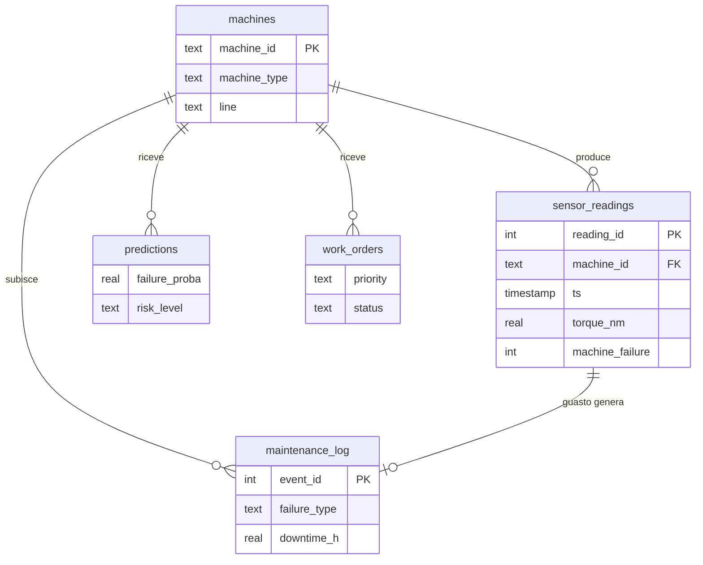

# 2. Database e SQL

**File:** `data/database.py`, `ml/score.py`, tool `sql_query` in `agent/tools.py`

## Lo schema



Il dataset AI4I non ha né macchine né timestamp: li aggiungiamo noi (`_assign_machines`). Ogni lavorazione viene assegnata a una macchina del suo tipo, con una lettura ogni 3 minuti. Il risultato è uno stabilimento di 20 macchine su 3 linee con circa 3 settimane di storico.

## Concetti SQL presenti nel progetto

**Vincoli** (`SCHEMA_SQL`): `PRIMARY KEY`, `REFERENCES` (chiavi esterne), `CHECK (machine_type IN ('L','M','H'))`. È il database stesso a rifiutare dati incoerenti.

**Indici**: `CREATE INDEX idx_readings_machine_ts ON sensor_readings(machine_id, ts)`. Le query "ultime letture della macchina X" non scansionano tutta la tabella.

**Viste**: query salvate con un nome. `v_latest_reading` usa un JOIN con una sottoquery aggregata per trovare l'ultima lettura di ogni macchina:
```sql
SELECT r.* FROM sensor_readings r
JOIN (SELECT machine_id, MAX(ts) AS max_ts FROM sensor_readings GROUP BY machine_id) last
  ON r.machine_id = last.machine_id AND r.ts = last.max_ts;
```

**Window function** (`score.py`): le ultime N letture per macchina.
```sql
ROW_NUMBER() OVER (PARTITION BY machine_id ORDER BY ts DESC) AS rn
```

**Query parametrizzate** (`tools.py`): mai concatenare input esterni nel testo SQL.
```python
conn.execute("INSERT INTO work_orders (...) VALUES (?, ?, ?, ?, ?)", (machine_id, ...))
```

## Text-to-SQL: l'agente scrive le query

Il tool `sql_query` riceve SQL scritto dall'LLM. È potente, perché l'agente può rispondere a domande non previste, ma anche rischioso. Lo proteggiamo su tre livelli indipendenti:

1. **parser** (`guardrails.validate_sql`): solo SELECT, tabelle in whitelist, LIMIT forzato;
2. **connessione read-only** (`connect_readonly`): `mode=ro` + `PRAGMA query_only`;
3. **timeout** con `set_progress_handler`: una query pesante viene interrotta.

Lo schema viene inserito nel system prompt (`describe_schema`), letto dal database con `PRAGMA table_info`. Così l'agente conosce sempre i nomi esatti delle colonne.

## Esercizi

1. Scrivi la query: *tempo di fermo totale per linea e per tipo di guasto, ordinato dal più alto*.
2. Crea una vista `v_daily_failures` con il numero di guasti per giorno (`date(ts)`) e per linea. Aggiungila a `READABLE_TABLES` e chiedi all'agente di usarla.
3. Con una window function, trova per ogni macchina la differenza di usura tra letture consecutive (`LAG`). Dove si azzera? Cosa rappresenta?
4. **Sicurezza**: prova a far eseguire all'agente `SELECT * FROM sqlite_master`. Quale livello lo blocca? E se rimuovessi il parser, quale livello resterebbe?
5. Migra il progetto a PostgreSQL: quali parti di `database.py` cambierebbero? (Suggerimento: `mode=ro` non esiste, si usa un utente con soli permessi `SELECT`.)
