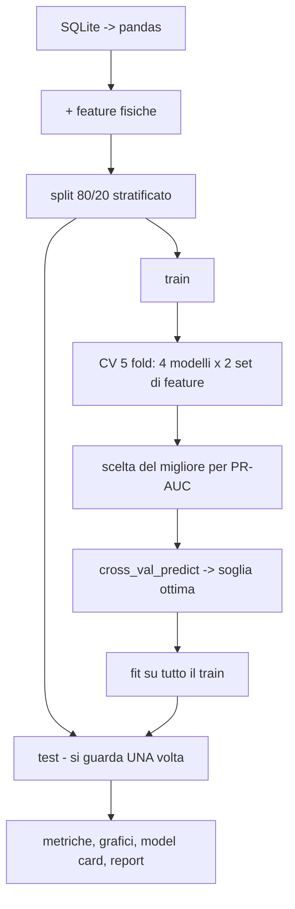

# 3. Modello con scikit-learn

**File:** `ml/train.py`, `ml/predictor.py`, `ml/plots.py`, `ml/score.py`

## Il problema: classi sbilanciate

Solo il 3-5% delle lavorazioni porta a un guasto. Un modello che risponde sempre "nessun guasto" ha il 96% di accuracy ed è inutile. Le contromisure:

| Problema | Soluzione nel codice |
|---|---|
| Train e test con proporzioni diverse | `train_test_split(..., stratify=y)` e `StratifiedKFold` |
| Il modello ignora la classe rara | `class_weight="balanced"` |
| L'accuracy inganna | **PR-AUC** (average precision) come metrica principale |
| La soglia 0,5 non è ottimale | soglia scelta massimizzando F1 su predizioni out-of-fold |

## Il flusso di `train_and_evaluate`



## La Pipeline

```python
Pipeline([
    ("preprocessing", ColumnTransformer([
        ("num", StandardScaler(), numeric_columns),
        ("cat", OneHotEncoder(handle_unknown="ignore"), ["machine_type"]),
    ])),
    ("model", RandomForestClassifier(...)),
])
```

Perché è importante: in cross-validation lo scaler viene adattato **solo sui fold di training**. Se scalassi tutto prima dello split, la media del test entrerebbe nel training (*leakage*). Inoltre la pipeline è l'oggetto che salviamo: in produzione riceve dati grezzi e fa tutto da sola.

## L'esperimento di ablation

`ml/train.py` addestra ogni modello due volte: con le sole feature grezze e con l'aggiunta di quelle fisiche. Il grafico `reports/figures/model_comparison.png` mostra la differenza. Su dati sintetici la regressione logistica passa da circa 0,15 a 0,54 di PR-AUC, e anche le random forest migliorano. È una prova concreta che **conoscere il dominio batte aggiungere complessità**.

## Dalla probabilità alla spiegazione

`predictor.explain_risk_factors` confronta i valori con le soglie di `domain.py` e restituisce frasi come:

> OSF: usura x coppia 12600 > limite 11000 per macchine di tipo L

È explainability "di dominio": semplice, verificabile, comprensibile da un manutentore. Per spiegazioni basate sul modello stesso si usano SHAP o la permutation importance (vedi `model_feature_importance.png`).

## Model card

`artifacts/model_card.json` documenta versione, algoritmo, feature, soglia, metriche, origine dei dati, uso previsto e limiti. È una pratica MLOps standard: chi usa il modello sa cosa aspettarsi.

## Esercizi

1. **Soglia per costi**: un guasto non previsto costa 5000 €, un'ispezione inutile 200 €. Scrivi `choose_threshold_by_cost` che minimizza `5000·FN + 200·FP` e confronta la soglia con quella di F1.
2. **Split temporale**: sostituisci lo split casuale con uno per data (ultimi 4 giorni come test). Le metriche cambiano? Perché in produzione è più onesto?
3. **Multi-classe**: addestra un secondo modello che predice la *modalità* di guasto (TWF/HDF/...). Quale modalità è più difficile? (Suggerimento: RNF.)
4. **Calibrazione**: usa `CalibratedClassifierCV` e confronta le probabilità con `calibration_curve`. Una probabilità del 30% corrisponde davvero al 30% di guasti?
5. **Iperparametri**: aggiungi una `RandomizedSearchCV` per la random forest. Il guadagno giustifica il tempo di calcolo?
