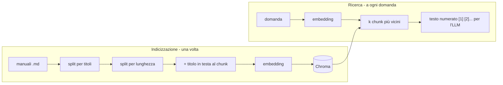

# 4. RAG sui manuali

**File:** `data/manuals/*.md`, `rag/ingest.py`, `rag/retriever.py`, `agent/llm.py`, tool `search_manual`

## Cos'è il RAG

**Retrieval-Augmented Generation**: prima di rispondere, l'LLM riceve i pezzi di documentazione pertinenti alla domanda. Risolve due problemi:

- l'LLM non conosce i *tuoi* documenti (procedure, soglie, priorità);
- senza fonti, l'LLM tende a inventare (*allucinazioni*).

## Le due fasi



## Scelte progettuali (e perché)

| Scelta | Motivo |
|---|---|
| Split prima per titoli `#`/`##` | una procedura o una tabella non viene spezzata a metà |
| `chunk_size=900`, `overlap=120` | sezioni brevi restano intere; l'overlap evita di perdere frasi a cavallo |
| Titolo e sezione premessi al chunk | "Tempo di intervento: 2-6 ore" da solo non dice di quale guasto parla |
| Id deterministici (hash) | re-indicizzare non crea duplicati |
| Distanza coseno | standard per embedding di testo |
| Prefissi `search_document:` / `search_query:` | richiesti dalla model card di `nomic-embed-text` |
| Metadati `source` e `section` | permettono le citazioni verificabili |

## Embedding in due righe

Un embedding trasforma un testo in un vettore (per `nomic-embed-text`, 768 numeri). Testi con significato simile producono vettori vicini. La ricerca diventa quindi un problema geometrico: trovare i vettori più vicini a quello della domanda. Chroma lo fa con un indice HNSW, che evita di confrontare la domanda con tutti i chunk.

## Citazioni

`format_chunks_for_llm` numera i chunk:
```text
[1] (fonte: 02_hdf_dissipazione_termica.md › Diagnosi)
Guasto HDF — dissipazione termica insufficiente › Diagnosi
1. Verificare il funzionamento della ventola...
```
Il system prompt chiede all'agente di citare `[1]`, `[2]`. Se se ne dimentica, il guardrail di uscita aggiunge le fonti (vedi [Guardrail](06-guardrail.md)).

## Esercizi

1. **Chunk size**: prova `PMC_CHUNK_SIZE=400` e `1500`, ri-esegui `pmc ingest` e `pmc eval retrieval`. Come cambiano hit@1 e MRR?
2. **Ricerca ibrida**: aggiungi BM25 (pacchetto `rank_bm25`) e combina i due ranking con *Reciprocal Rank Fusion*: `score = Σ 1/(60 + rank)`. Migliora sulle domande con numeri esatti come "8,6 K"?
3. **Re-ranking**: recupera 10 chunk e chiedi all'LLM di ordinarli per pertinenza prima di tenerne 4. Misura il guadagno e il costo in latenza.
4. **Nuovo documento**: scrivi `08_lubrificazione.md`, indicizzalo, aggiungi 3 domande al golden set e verifica che vengano trovate.
5. **Domanda di approfondimento**: come gestiresti manuali in PDF con tabelle e immagini?
