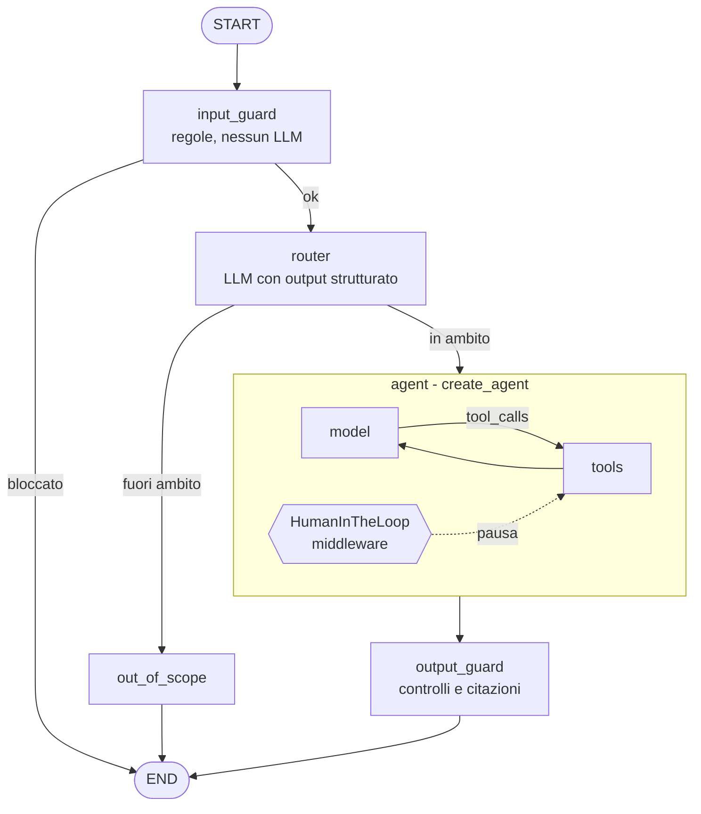

# 5. Agente: LangChain + LangGraph

**File:** `agent/tools.py`, `agent/prompts.py`, `agent/graph.py`, `agent/service.py`, `agent/llm.py`

## LangChain e LangGraph: chi fa cosa

| | LangChain | LangGraph |
|---|---|---|
| Livello | componenti e agente pronto | motore di orchestrazione a grafo |
| Qui lo usiamo per | `ChatOllama`, embedding, tool, `create_agent`, middleware | il flusso esterno: guardrail → router → agente → guardrail |
| Chi decide i passi | il modello (ciclo ReAct) | tu, con nodi e archi |

`create_agent` restituisce già un grafo LangGraph compilato. Per questo possiamo inserirlo come **nodo** dentro il nostro `StateGraph`: è un sottografo.

## Il grafo



**Perché non lasciare tutto all'agente?** I controlli di sicurezza devono girare *sempre*, non quando il modello "se ne ricorda". Nodi deterministici prima e dopo l'agente lo garantiscono. È il pattern che ritrovi nei sistemi in produzione: **controllo dove serve, autonomia dove aiuta**.

## Lo stato

```python
class CopilotState(MessagesState):   # messages con reducer add_messages
    route: str
    guard_flags: list[str]
    tools_used: list[str]
    sources: list[str]
    charts: list[str]
```

Ogni nodo riceve lo stato e restituisce **solo le chiavi che cambia**. Per `messages` il reducer `add_messages` *accoda* i nuovi messaggi, oppure *sostituisce* quelli con lo stesso `id`. `output_guard` sfrutta questo meccanismo per correggere la risposta finale.

## I tool

Un tool è composto da una funzione, una descrizione e uno schema degli argomenti. L'LLM **legge la docstring** per decidere quando usarlo, quindi le docstring in `tools.py` sono scritte per il modello: dicono quando usarlo, cosa restituisce e cosa fare in caso di errore.

Due dettagli importanti:

- **`content_and_artifact`**: il tool restituisce testo per l'LLM e dati strutturati per il nostro codice (fonti, nome del grafico). L'LLM non vede l'artifact.
- **Errori come testo**: `"ERRORE: la macchina 'M99' non esiste. Codici validi: ..."`. L'agente legge il messaggio e si corregge. Questo ciclo di autocorrezione è possibile proprio perché il grafo ha un *loop* model → tools → model.

## Middleware di `create_agent`

```python
middleware=[
    HumanInTheLoopMiddleware(interrupt_on={"open_work_order": {"allowed_decisions": ["approve", "reject"]}}),
    ModelCallLimitMiddleware(run_limit=8, exit_behavior="end"),
    ToolCallLimitMiddleware(run_limit=10, exit_behavior="continue"),
]
```

I middleware si agganciano al ciclo dell'agente (prima/dopo il modello, attorno ai tool) senza riscriverlo.

## Human-in-the-loop

1. L'agente decide di chiamare `open_work_order`.
2. Il middleware lancia un `interrupt`: il grafo si **ferma** e lo stato viene salvato dal checkpointer.
3. `service.chat()` vede l'interrupt in `graph.get_state(config).interrupts` e restituisce `pending_approval`.
4. Più tardi, anche da un'altra richiesta HTTP, `service.decide()` invoca `Command(resume={"decisions": [{"type": "approve"}]})`.
5. Il grafo riparte esattamente da dove si era fermato.

Senza checkpointer niente di questo sarebbe possibile. Lo stesso meccanismo dà la **memoria multi-turno**: stesso `thread_id`, stessa conversazione.

## Il router con output strutturato

```python
structured_router = llm.with_structured_output(RouteDecision)
decision = structured_router.invoke(prompt)   # -> RouteDecision(route="in_scope", reason="...")
```

Con Ollama, `with_structured_output` passa lo schema JSON al parametro `format`: il modello è vincolato a produrre JSON valido. Se fallisce comunque, il router *non blocca* e assume `in_scope`. È meglio una risposta in più che un utente bloccato per un errore tecnico.

## Esercizi

1. **Nuovo tool**: `get_maintenance_history(machine_id, last_n)` che restituisce gli ultimi interventi. Scrivi una docstring efficace e un test con `ScriptedChatModel`.
2. **Interrupt "edit"**: aggiungi `"edit"` alle decisioni ammesse e permetti dall'API di cambiare la priorità dell'ordine prima di approvarlo.
3. **Memoria persistente**: sostituisci `InMemorySaver` con `SqliteSaver` (`pip install langgraph-checkpoint-sqlite`) e verifica che una conversazione sopravviva al riavvio dell'API.
4. **Streaming**: usa `graph.stream(..., stream_mode="updates")` nella CLI per mostrare ogni nodo mentre viene eseguito.
5. **Memoria lunga**: il contatore del contesto nella console mostra quanto si riempie la finestra di Ollama (`PMC_LLM_NUM_CTX`). Aggiungi `SummarizationMiddleware` a `create_agent` perché riassuma i messaggi vecchi quando il contesto supera, per esempio, il 70%. Confronta le risposte prima e dopo in una conversazione di 15 turni.
6. **Multi-agente**: dividi l'agente in due specialisti (dati e manuali) coordinati da un supervisore. Quando conviene davvero? Quando è complessità inutile?
