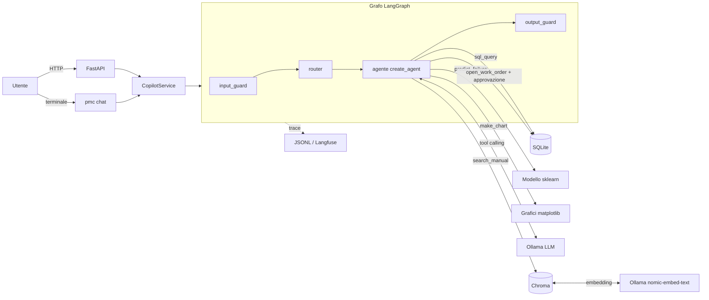

# Predictive Maintenance Copilot

Un assistente per la manutenzione di uno stabilimento di fresatrici CNC. Risponde a domande come:

- *"Quali macchine sono a rischio alto in questo momento?"*
- *"Cosa succede alla M07 se la coppia sale a 65 Nm?"*
- *"Quanti guasti HDF ha avuto la Linea 1 e cosa prevede il manuale?"*
- *"Apri un ordine di lavoro P2 per la M05"* (solo dopo un sì umano)

Per farlo combina un **modello di machine learning** (scikit-learn), un **database** (SQL), una **ricerca nei manuali** (RAG) e un **agente** (LangChain + LangGraph) che decide quale strumento usare. Tutto gira **in locale** con un LLM open-weight tramite **Ollama**.

## Architettura

## Dove trovi ogni tecnologia

| Tecnologia | File principali | Capitolo |
|---|---|---|
| numpy, pandas | `data/synthetic.py`, `data/features.py`, `analysis/eda.py` | [1. Dati](01-dati.md) |
| SQL | `data/database.py`, tool `sql_query` | [2. SQL](02-sql.md) |
| scikit-learn, matplotlib | `ml/train.py`, `ml/predictor.py`, `ml/plots.py` | [3. Modello](03-modello.md) |
| RAG | `rag/ingest.py`, `rag/retriever.py` | [4. RAG](04-rag.md) |
| LangChain, LangGraph | `agent/tools.py`, `agent/graph.py` | [5. Agente](05-agente.md) |
| Guardrail | `agent/guardrails.py` + middleware | [6. Guardrail](06-guardrail.md) |
| FastAPI e console web | `api/main.py`, `api/ui_routes.py`, `api/static/` | [7. API](07-api.md) |
| Observability | `observability/*` | [8. Observability](08-observability.md) |
| Evaluation | `evaluation/*`, `eval/datasets/` | [9. Evaluation](09-evaluation.md) |

Tutti i percorsi sono relativi a `src/pmcopilot/`.

## Come studiare questo progetto

1. Fai funzionare tutto con [Per iniziare](00-setup.md): vedere il risultato prima motiva a capire i pezzi.
2. Segui i capitoli **nell'ordine**: ognuno usa quello che produce il precedente.
3. Per ogni capitolo: leggi la teoria, poi apri i file indicati e leggi i commenti. Ogni file inizia con un blocco che spiega *perché* esiste.
4. Fai gli **esercizi** in fondo a ogni capitolo. Sono il modo per trasformare "l'ho letto" in "lo so fare".

!!! tip "Il flusso di una domanda, in una frase"
    La domanda passa i controlli di sicurezza, un LLM verifica che sia pertinente, l'agente sceglie e chiama gli strumenti (anche più volte, correggendosi), la risposta viene controllata e arricchita con le fonti, e ogni passo viene tracciato.
