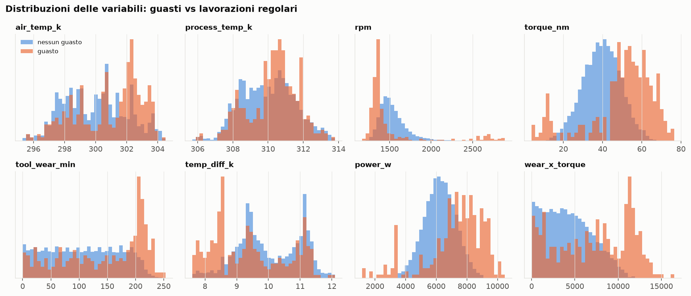
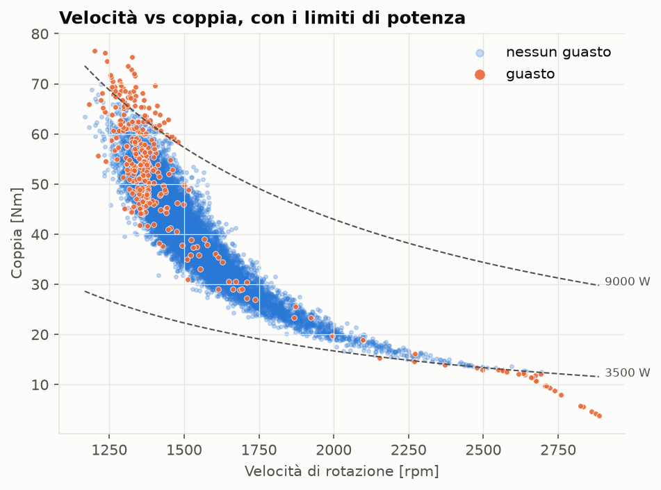
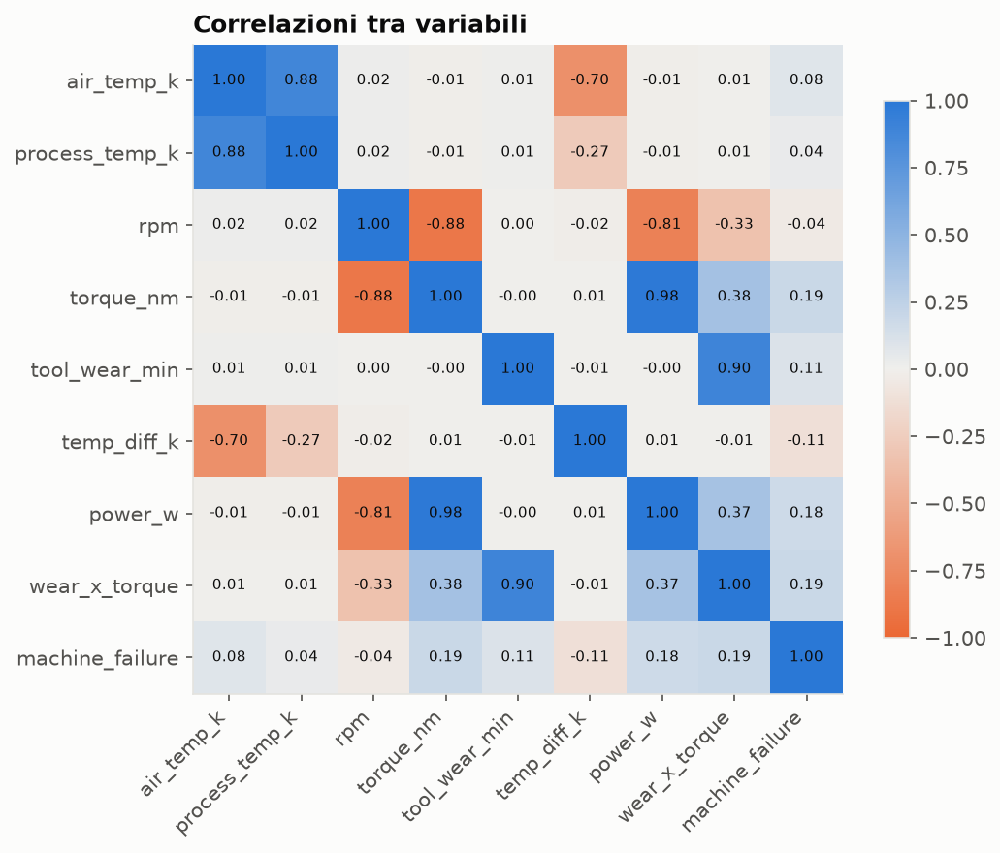
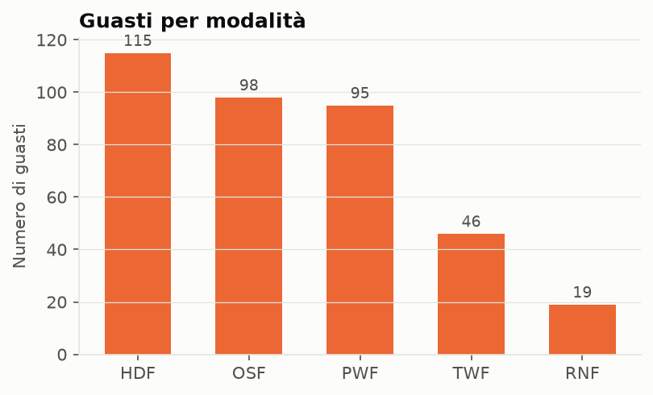

# EDA — riepilogo

Righe: 10000 · guasti: 339 (3.39%)

## Tasso di guasto per tipo di macchina
| machine_type   |   n_readings |   n_failures |   failure_rate |
|:---------------|-------------:|-------------:|---------------:|
| L              |    6000.0000 |     235.0000 |         0.0392 |
| M              |    2997.0000 |      83.0000 |         0.0277 |
| H              |    1003.0000 |      21.0000 |         0.0209 |

## Guasti per modalità
|     |   n |
|:----|----:|
| HDF | 115 |
| OSF |  98 |
| PWF |  95 |
| TWF |  46 |
| RNF |  19 |

## Statistiche descrittive
|                |    count |    mean |     std |     min |     25% |     50% |     75% |      max |
|:---------------|---------:|--------:|--------:|--------:|--------:|--------:|--------:|---------:|
| air_temp_k     | 10000.00 |  300.00 |    2.00 |  295.30 |  298.30 |  300.10 |  301.50 |   304.50 |
| process_temp_k | 10000.00 |  310.01 |    1.48 |  305.70 |  308.80 |  310.10 |  311.10 |   313.80 |
| rpm            | 10000.00 | 1538.78 |  179.28 | 1168.00 | 1423.00 | 1503.00 | 1612.00 |  2886.00 |
| torque_nm      | 10000.00 |   39.99 |    9.97 |    3.80 |   33.20 |   40.10 |   46.80 |    76.60 |
| tool_wear_min  | 10000.00 |  107.95 |   63.65 |    0.00 |   53.00 |  108.00 |  162.00 |   253.00 |
| temp_diff_k    | 10000.00 |   10.00 |    1.00 |    7.60 |    9.30 |    9.80 |   11.00 |    12.10 |
| power_w        | 10000.00 | 6279.74 | 1067.42 | 1148.44 | 5561.18 | 6271.03 | 7003.00 | 10469.92 |
| wear_x_torque  | 10000.00 | 4314.66 | 2826.57 |    0.00 | 1963.65 | 4012.95 | 6279.00 | 16497.00 |

