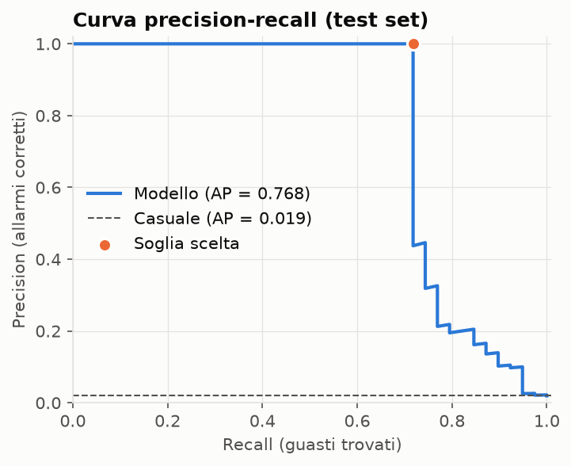
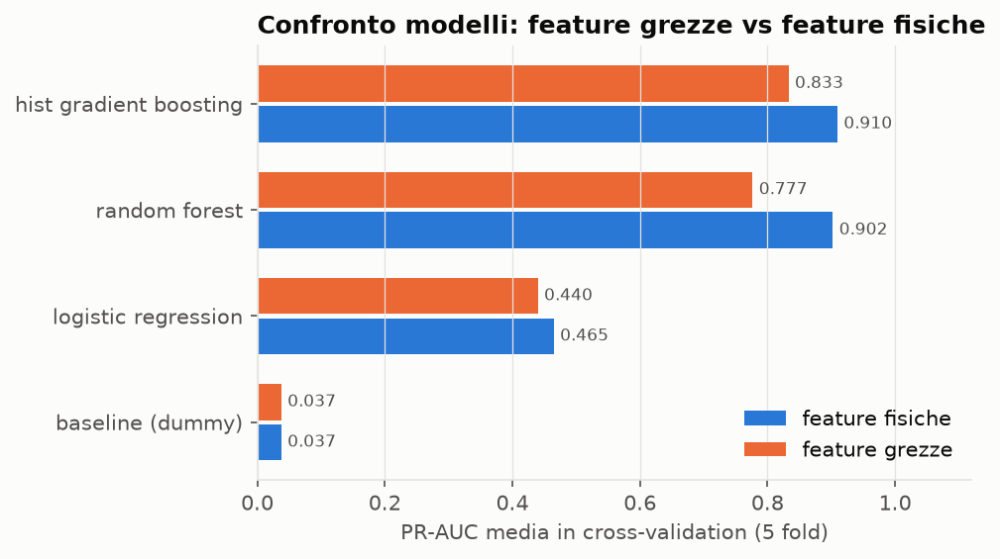
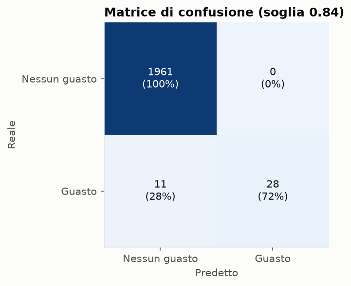
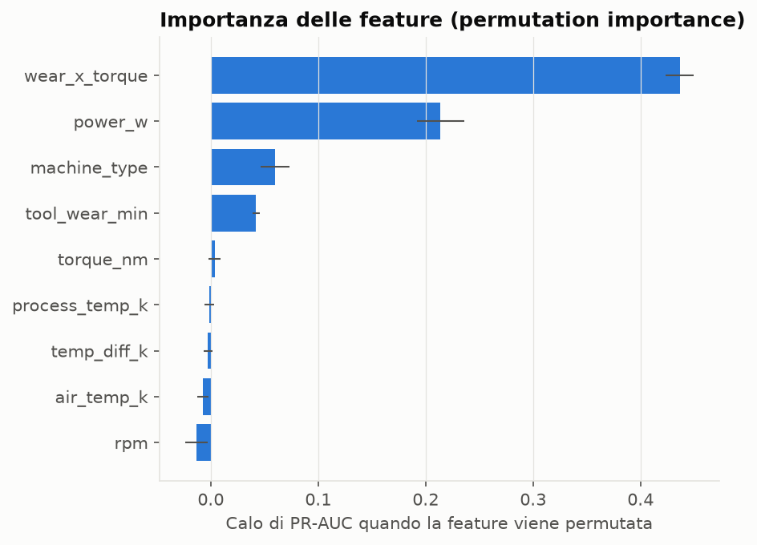

# Model report — hist_gradient_boosting-20261103102623

Dati: **uci** · split **temporal** · train 8000 righe · test 2000 righe ·
guasti nel test 1.95%

## Modello scelto
**hist gradient boosting** con feature **fisiche**, soglia di decisione **0.844**
(scelta massimizzando F1 su predizioni out-of-fold del train).

## Metriche sul test set (valutato una sola volta)
| PR-AUC | ROC-AUC | Precision | Recall | F1 |
|---|---|---|---|---|
| 0.768 | 0.939 | 1.000 | 0.718 | 0.836 |

Matrice di confusione (righe = reale, colonne = predetto): TN 1961, FP 0, FN 11, TP 28

## Confronto in cross-validation
| model                  | features   |   cv_pr_auc_mean |   cv_pr_auc_std |   cv_roc_auc_mean |
|:-----------------------|:-----------|-----------------:|----------------:|------------------:|
| hist gradient boosting | fisiche    |            0.910 |           0.031 |             0.975 |
| random forest          | fisiche    |            0.902 |           0.036 |             0.981 |
| hist gradient boosting | grezze     |            0.833 |           0.052 |             0.973 |
| random forest          | grezze     |            0.777 |           0.055 |             0.969 |
| logistic regression    | fisiche    |            0.465 |           0.041 |             0.926 |
| logistic regression    | grezze     |            0.440 |           0.051 |             0.895 |
| baseline (dummy)       | grezze     |            0.037 |           0.000 |             0.500 |
| baseline (dummy)       | fisiche    |            0.037 |           0.000 |             0.500 |

## Grafici

